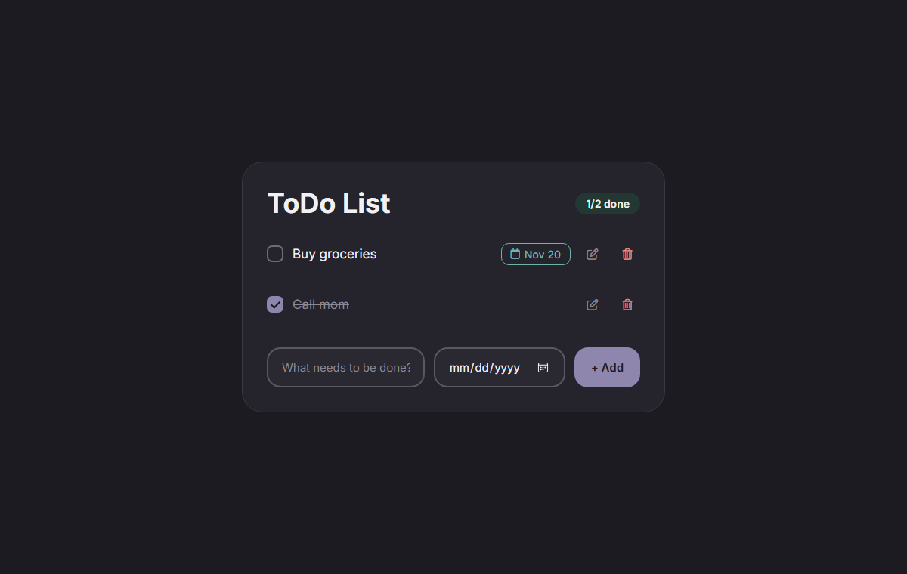
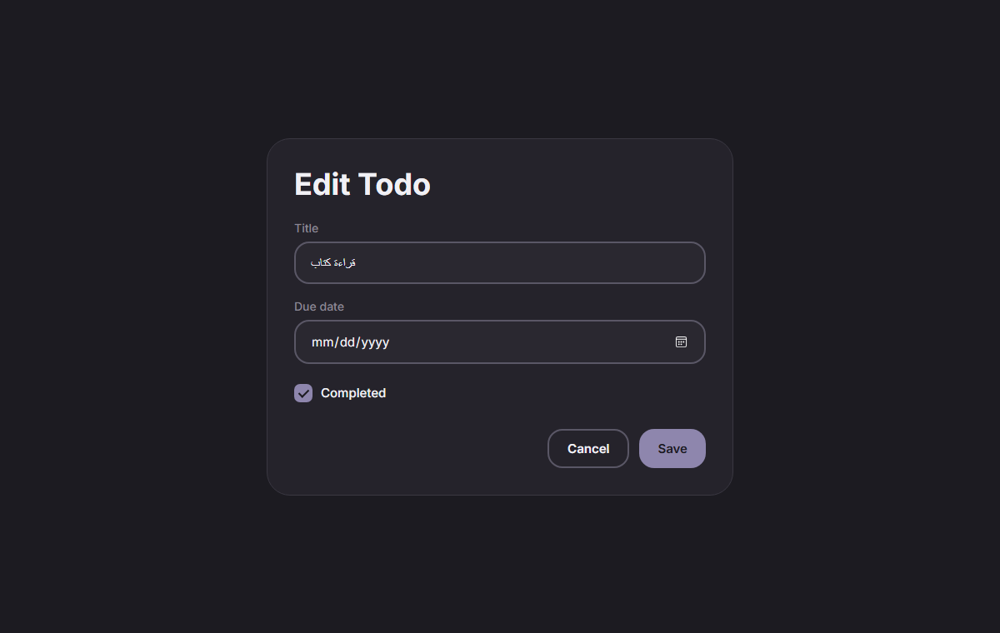
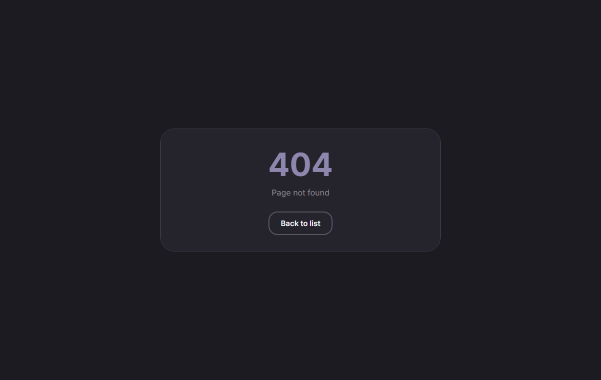

# Todo MVC Express

A full-stack todo app built with **Node.js**, **Express**, **MongoDB** and **EJS**, structured with the **MVC** pattern.



## Features

- **Create** todos with an optional due date
- **Read** all todos from MongoDB, with a done/total counter
- **Update** a todo's title, due date and status on its own edit page
- **Toggle** a todo as done straight from the list
- **Delete** todos
- Friendly **404 / 500 error pages** (invalid or missing IDs never crash the server)
- Empty-state message when there are no todos
- Dark theme, responsive down to mobile, with Arabic font support

| Edit page | Error page |
| --------- | ---------- |
|  |  |

## Tech Stack

| Layer    | Tools                                  |
| -------- | -------------------------------------- |
| Server   | Node.js, Express 5                     |
| Database | MongoDB, Mongoose                      |
| Views    | EJS templates with partials            |
| Styling  | Hand-written CSS (custom properties), Font Awesome |
| Other    | dotenv, method-override                |

## Project Structure

```
├── config/
│   └── db.js                 # MongoDB connection
├── models/
│   └── Todo.js               # Todo schema: title, completed, dueDate
├── controllers/
│   └── todoController.js     # Logic for each action
├── routes/
│   └── todoRoutes.js         # Maps URLs + HTTP methods to controllers
├── views/
│   ├── partials/             # Shared header and footer
│   ├── index.ejs             # Todo list
│   ├── edit.ejs              # Edit form
│   └── error.ejs             # 404 / 500 page
├── public/
│   └── css/style.css
└── server.js                 # App setup, middleware, error handling
```

**Request flow:** `route → controller → model → view`

## Routes

| Method | URL                   | Action                 |
| ------ | --------------------- | ---------------------- |
| GET    | `/`                   | List all todos         |
| POST   | `/todos`              | Create a todo          |
| GET    | `/todos/:id/edit`     | Show the edit form     |
| PUT    | `/todos/:id`          | Update a todo          |
| PATCH  | `/todos/:id/toggle`   | Toggle done / not done |
| DELETE | `/todos/:id`          | Delete a todo          |

HTML forms only send GET and POST, so PUT, PATCH and DELETE go through `method-override` (`?_method=...`).

## Run Locally

**Requirements:** Node.js 22+ and MongoDB running locally.

```bash
git clone https://github.com/SirAnwar/todo-mvc-express.git
cd todo-mvc-express
npm install
```

Create a `.env` file in the project root:

```
MONGO_URI=mongodb://127.0.0.1:27017/todoDB
PORT=3000
```

Start the dev server (restarts on file changes):

```bash
npm run dev
```

Then open http://localhost:3000.
